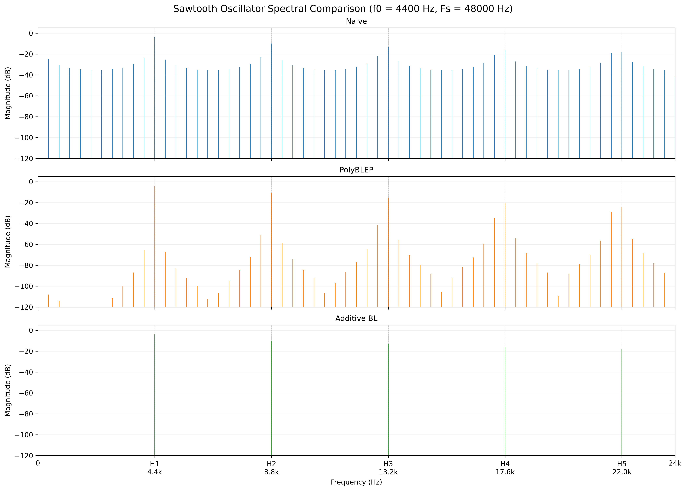
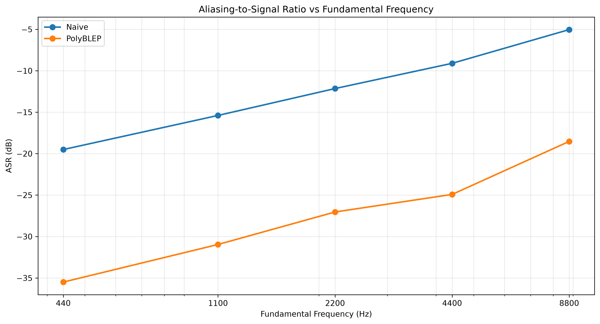
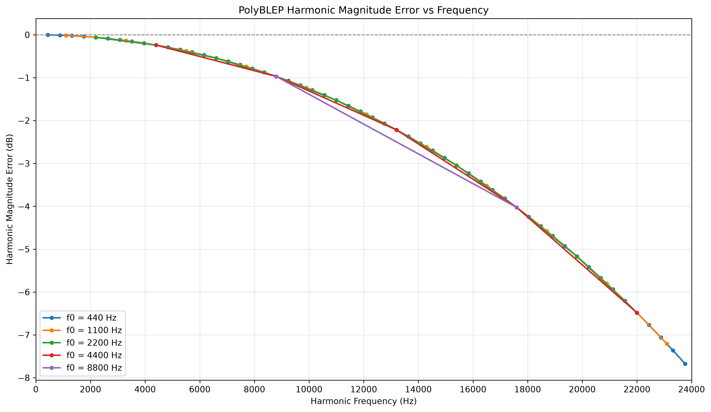
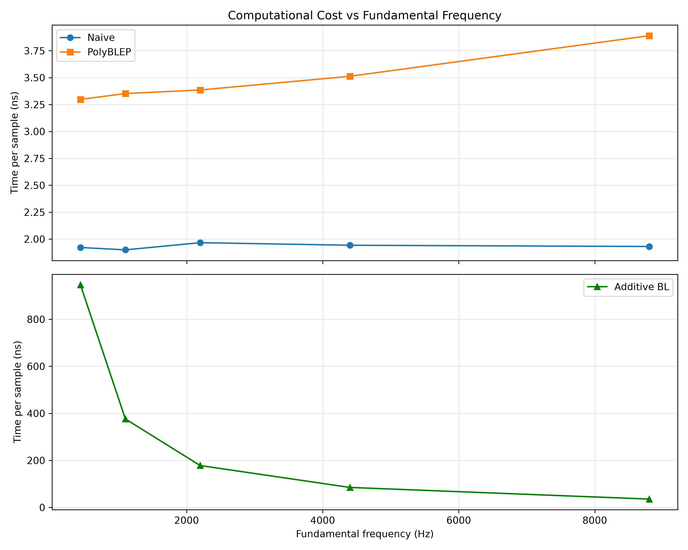
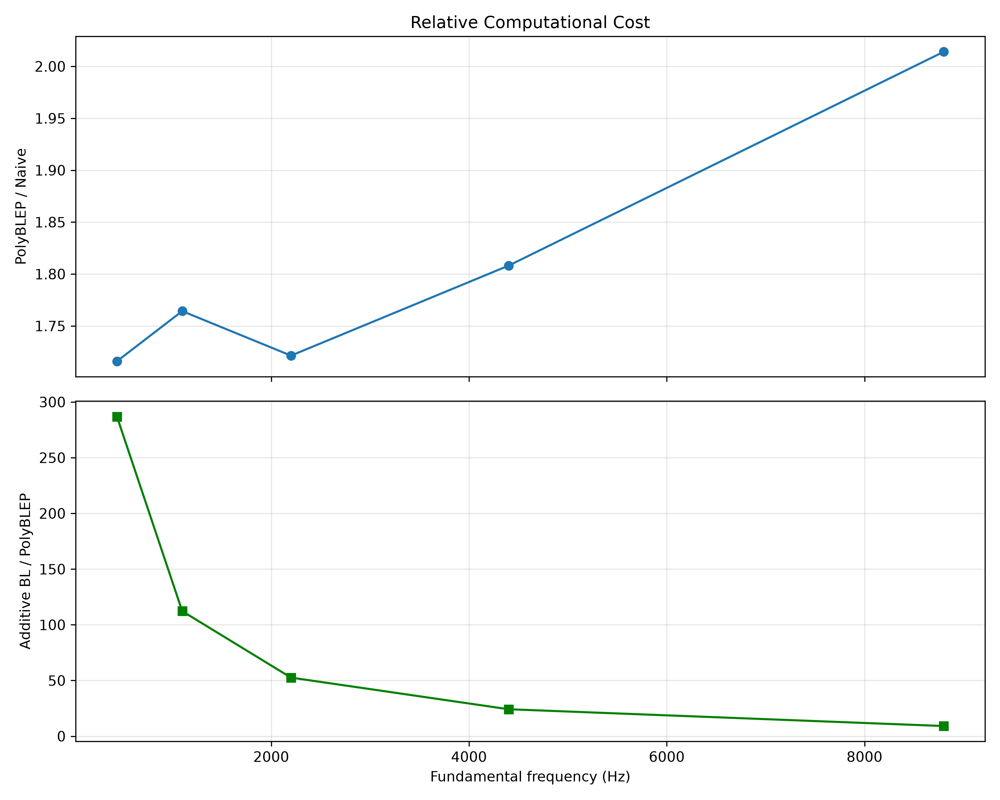

# Evaluating Aliasing Suppression and Computational Efficiency in Digital Audio Oscillators

**A personal DSP research project focused on digital audio synthesis.**

## Overview

Digital oscillators are widely used in audio synthesis, but generating certain waveforms digitally can introduce unwanted spectral artifacts. One example is the sawtooth waveform, whose sharp discontinuities produce harmonics that extend beyond the Nyquist frequency and can fold back into the audible spectrum as aliasing.

I started this project to explore how different oscillator algorithms address this problem and what trade-offs they introduce in terms of sound quality and computational cost.

The project compares three sawtooth oscillator implementations:

- **Naive Sawtooth** — a basic implementation without antialiasing.
- **PolyBLEP Sawtooth** — uses polynomial corrections around waveform discontinuities to reduce aliasing.
- **Additive Band-Limited Sawtooth** — generates the waveform by summing harmonics below the Nyquist frequency.

The oscillators are implemented in C# (.NET), while Python is used for spectral analysis and visualization of the results.

## Research Question

*How do different digital oscillator algorithms balance spectral accuracy, aliasing suppression, and computational efficiency across the audible frequency range?*

To explore this question, the project evaluates three aspects of oscillator performance:

1. **Aliasing suppression** — measuring unwanted spectral energy outside the expected harmonic frequencies.
2. **Spectral accuracy** — comparing harmonic amplitudes against a band-limited reference.
3. **Computational efficiency** — measuring the time required to generate individual samples.

The experiments use a sample rate of 48 kHz and several fundamental frequencies to examine how these characteristics change across different parts of the audible range.

## Background & Algorithms

### Why does aliasing occur?

An ideal sawtooth waveform contains an infinite number of harmonics, with amplitudes decreasing as the harmonic number increases.

In digital audio, the highest frequency that can be represented without aliasing is the **Nyquist frequency**, equal to half the sample rate. At 48 kHz, this limit is 24 kHz.

When a waveform is generated without proper band-limiting, harmonics above this limit fold back into lower frequencies, creating spectral components that are not part of the intended signal.

This makes sawtooth oscillators an interesting example for exploring antialiasing techniques in digital sound synthesis.

### Oscillator Algorithms

**1. Naive Sawtooth**

The simplest implementation generates a sawtooth directly from a normalized phase:

$$
x(\phi)=2\phi-1,\qquad 0\leq\phi<1
$$

The phase increases from 0 to 1 before wrapping around, creating a sharp discontinuity. This approach is computationally inexpensive but does not explicitly suppress aliasing.

**2. PolyBLEP Sawtooth**

PolyBLEP (Polynomial Band-Limited Step) reduces aliasing by applying a short polynomial correction around the waveform discontinuity.

The oscillator starts with a naive sawtooth and subtracts a correction function near the phase wrap:

$$
x_{\mathrm{PolyBLEP}}(\phi)=2\phi-1-B(\phi,\Delta)
$$

Here, $\phi$ is the normalized phase, $\Delta=f_0/f_s$ is the phase increment per sample, and $B$ is a piecewise polynomial correction applied near the discontinuity.

This reduces unwanted spectral components while requiring relatively little additional computation. However, PolyBLEP also modifies the amplitudes of some desired harmonics, introducing a trade-off between aliasing suppression and spectral accuracy.

**3. Additive Band-Limited Sawtooth**

Additive synthesis constructs the waveform by summing individual sinusoidal harmonics:

$$
x(\phi)=-\frac{2}{\pi}
\sum_{k=1}^{K}\frac{\sin(2\pi k\phi)}{k}
$$

Here, $K$ is the number of harmonics below the Nyquist frequency.

By excluding harmonics above this limit, the oscillator avoids the aliasing associated with directly generating a non-band-limited sawtooth.

However, evaluating multiple sine functions for each output sample makes this approach more computationally expensive, particularly at lower fundamental frequencies where more harmonics are required.

In this project, the additive oscillator serves as the spectral reference for comparing the other implementations.

## Implementation & Experimental Setup

### Tools and Implementation

The project uses **C# (.NET)** to implement the oscillators and generate audio samples, while **Python (NumPy and Matplotlib)** handles spectral analysis and visualization.

All three oscillators use the same sample rate and fundamental frequencies to make their outputs directly comparable.

The naive and PolyBLEP oscillators use an integer-based phase accumulator to avoid cumulative floating-point phase errors. The additive oscillator calculates each harmonic directly from the sample index.

Generated samples are exported to CSV files for further analysis in Python.

### Test Configuration

| Parameter | Value |
|---|---|
| Sample rate | 48,000 Hz |
| Fundamental frequencies | 440, 1,100, 2,200, 4,400, 8,800 Hz |
| Signal length | 4,800 samples (100 ms) |
| FFT size | 4,800 points |
| Nyquist frequency | 24,000 Hz |
| Waveform | Sawtooth |

The selected frequencies cover different parts of the audible range and allow comparisons as the number of available harmonics decreases toward the Nyquist limit.

### Spectral Analysis

The generated signals are analyzed using the Fast Fourier Transform (FFT).

The test frequencies were selected so that each signal contains an integer number of cycles within the analysis window. This allows coherent sampling and avoids spectral leakage caused by truncating an incomplete waveform period.

A rectangular analysis window is used without additional windowing.

The resulting spectra are used to compare unwanted spectral components and the amplitudes of expected harmonics.

### Performance Benchmarking

Computational performance is measured using a custom C# benchmark based on `Stopwatch.GetTimestamp()`.

Each oscillator is tested at five fundamental frequencies, with 48,000 samples generated per measurement.

To improve measurement consistency:

- All configurations are warmed up for 30 rounds before timing begins.
- Each configuration is measured 100 times.
- The execution order is shuffled between measurement rounds to reduce systematic ordering effects.
- Output buffers are allocated before timing, and oscillator state preparation is excluded from the measured interval.
- The median execution time is used to reduce the influence of occasional timing outliers.

Results are reported in **nanoseconds per sample (ns/sample)**.

The benchmark measures sample generation into preallocated buffers rather than complete real-time audio processing. Absolute timings may vary depending on the CPU, .NET runtime, and system conditions.

## Evaluation Metrics

Three main metrics are used to compare the oscillator implementations: spectral contamination, harmonic magnitude accuracy, and computational cost.

### 1. Aliasing-to-Signal Ratio (ASR)

ASR measures the ratio between spectral energy outside the expected harmonic frequencies and energy at those frequencies.

$$
ASR=10\log_{10}\left(\frac{E_{\mathrm{unwanted}}}{E_{\mathrm{harmonic}}}\right)
$$

The expected harmonics are integer multiples of the fundamental frequency below the Nyquist limit.

Lower ASR values (more negative dB) indicate less unwanted spectral energy relative to the expected harmonics.

In this implementation, ASR is calculated from FFT bins that do not correspond to expected harmonic frequencies, excluding DC.

An important limitation is that aliased components may overlap with expected harmonic bins. Therefore, this metric measures out-of-harmonic spectral contamination rather than the total energy of all aliased components.

### 2. Harmonic Magnitude Error (HME)

HME measures how the amplitude of each expected harmonic differs from the additive band-limited reference.

$$
HME_k=20\log_{10}\left(\frac{|X_{\mathrm{osc}}(k)|}{|X_{\mathrm{ref}}(k)|}\right)
$$

Here, $X_{\mathrm{osc}}(k)$ and $X_{\mathrm{ref}}(k)$ represent the FFT magnitudes at the frequency of harmonic $k$.

- **0 dB:** The harmonic amplitude matches the reference.
- **Negative values:** The harmonic is attenuated.
- **Positive values:** The harmonic is amplified relative to the reference.

HME helps reveal changes in the intended harmonic structure that may occur even when aliasing is reduced.

### 3. Computational Cost

Computational efficiency is measured as the median execution time required to generate one sample, expressed in **nanoseconds per sample (ns/sample)**.

Lower values indicate faster sample generation under the tested conditions.

This metric allows the spectral results to be considered alongside the processing cost of each algorithm.

### Additional Analysis: Squared-Sinc Reference

To better understand the harmonic attenuation observed in the PolyBLEP oscillator, its measured HME is also compared with a squared-sinc reference response:

$$
H(f)=\mathrm{sinc}^{2}\left(\frac{f}{f_s}\right)
$$

The corresponding magnitude response in decibels is:

$$
H_{\mathrm{dB}}(f)=20\log_{10}|H(f)|
$$

This comparison helps determine how closely the measured attenuation follows the reference model.

The squared-sinc response is used as an analytical comparison for the tested implementation, not as a universal response model for every PolyBLEP oscillator.

## Results & Discussion

### 1. Spectral Comparison

The FFT spectra illustrate how the three oscillator algorithms differ in their treatment of high-frequency harmonics and aliasing.

At a fundamental frequency of 4,400 Hz, the naive sawtooth produces additional spectral components outside the expected harmonic frequencies. These components result from aliasing of harmonics above the Nyquist limit.

PolyBLEP substantially reduces these unwanted components, although some spectral contamination remains.

The additive band-limited oscillator produces only the intended harmonics within the tested FFT resolution, making it a useful reference for comparing the other implementations.

### 2. Aliasing Suppression

The ASR results show how out-of-harmonic spectral contamination changes with fundamental frequency.

| Frequency | Naive ASR | PolyBLEP ASR |
|---|---:|---:|
| 440 Hz | −19.51 dB | −35.50 dB |
| 1,100 Hz | −15.39 dB | −30.96 dB |
| 2,200 Hz | −12.15 dB | −27.04 dB |
| 4,400 Hz | −9.10 dB | −24.92 dB |
| 8,800 Hz | −5.04 dB | −18.52 dB |

Across the tested frequencies, PolyBLEP achieves approximately **13.5–16 dB lower ASR** than the naive oscillator.

Both oscillators show increasing spectral contamination as the fundamental frequency rises. However, PolyBLEP consistently maintains lower ASR values.

The additive band-limited oscillator produces values near the numerical precision limit of the analysis (approximately −250 to −260 dB), reflecting the absence of out-of-harmonic components above numerical noise in these tests.

As noted in the methodology, ASR does not capture aliased components that overlap with expected harmonic frequencies.

### 3. Harmonic Magnitude Accuracy

Reducing aliasing does not necessarily mean preserving the exact amplitudes of the intended harmonics.

The HME results show that PolyBLEP closely matches the additive reference at lower harmonic frequencies but progressively attenuates higher harmonics.

The attenuation is largely determined by the absolute frequency of each harmonic rather than the oscillator's fundamental frequency.

An additional comparison with a squared-sinc reference model shows a close match between the measured PolyBLEP attenuation and the reference response under the tested conditions.

[View the squared-sinc deviation plot](plots/hme_theoretical_deviation.png)

This illustrates an important trade-off: PolyBLEP reduces unwanted spectral components while also changing the amplitudes of some desired high-frequency harmonics.

### 4. Computational Efficiency

The computational benchmark highlights substantial differences between the three oscillator implementations.

The naive oscillator is the fastest, requiring approximately 1.9–2.0 ns/sample across the tested frequencies.

PolyBLEP requires approximately 3.3–3.9 ns/sample, making it around 1.7–2.0 times slower than the naive implementation.

The additive band-limited oscillator is considerably more expensive, ranging from approximately 940 ns/sample at 440 Hz to 36 ns/sample at 8,800 Hz.

Its computational cost decreases as the fundamental frequency increases because fewer harmonics remain below the Nyquist limit.

Depending on the fundamental frequency, additive synthesis requires approximately 9–285 times more processing time per sample than PolyBLEP.

These results illustrate why PolyBLEP can be an attractive compromise for computationally efficient audio synthesis: it substantially reduces measured spectral contamination while adding relatively little processing overhead compared with the naive oscillator.

## Conclusions & Limitations

### Conclusions

This project explored how three sawtooth oscillator algorithms balance aliasing suppression, spectral accuracy, and computational efficiency.

The results revealed several interesting trade-offs:

- **Naive Sawtooth** was the fastest implementation, but produced the highest levels of out-of-harmonic spectral contamination.
- **PolyBLEP Sawtooth** reduced the measured ASR by approximately 13.5–16 dB compared with the naive oscillator, while requiring roughly 1.7–2.0 times more processing time. However, it also introduced increasing attenuation of higher-frequency harmonics.
- **Additive Band-Limited Sawtooth** provided a useful spectral reference with negligible out-of-harmonic energy in the tested signals, but required significantly more computation, especially at lower fundamental frequencies.

For these implementations, PolyBLEP appeared to offer the most practical balance between spectral quality and computational cost.

One particularly interesting observation was how closely the measured PolyBLEP harmonic attenuation followed the squared-sinc reference model. This helped connect the experimental results with the underlying signal-processing concepts.

Overall, the project provided a practical way to explore digital oscillator design and better understand the trade-offs involved in antialiased audio synthesis.

### Limitations

There are several limitations to consider when interpreting these results:

- **Waveform scope:** Only sawtooth oscillators were tested. Other waveforms may produce different results.
- **Frequency coverage:** The experiments used five selected fundamental frequencies rather than a continuous sweep across the audible range.
- **ASR measurement:** The metric does not account for aliased components that overlap with expected harmonic frequencies.
- **Reference model:** The squared-sinc comparison describes the observed behavior of the tested PolyBLEP implementation and should not be generalized to all PolyBLEP algorithms.
- **Benchmark environment:** Execution times depend on the hardware, .NET runtime, compiler optimizations, and measurement conditions.
- **Perceptual evaluation:** No listening tests were conducted, so the results describe spectral characteristics rather than perceived audio quality.

These limitations leave room for further exploration, including other waveform types, alternative antialiasing methods, and more detailed spectral measurements.

## Repository Structure

- `*.cs` — C# implementations of the oscillators, phase accumulator, data generation, and benchmarking.
- `analysis/` — Python scripts for spectral analysis, evaluation metrics, and visualization.
- `results/` — Generated oscillator samples and experimental results in CSV format.
- `plots/` — FFT spectra, ASR and HME comparisons, and computational performance figures.

## Running the Experiments

The project requires the .NET SDK and Python 3 with NumPy and Matplotlib.

The C# application generates sawtooth signals using the three oscillator algorithms and runs the computational benchmarks. The generated data is saved as CSV files in `results/`.

The Python scripts in `analysis/` process these files, calculate the spectral metrics, and generate the figures presented in this README.

The experiments can be reproduced by running the C# project in Release configuration, followed by the Python analysis scripts.

## References

Välimäki, V., & Huovilainen, A. (2007). *Antialiasing Oscillators in Subtractive Synthesis*. IEEE Signal Processing Magazine, 24(2), 116–125.